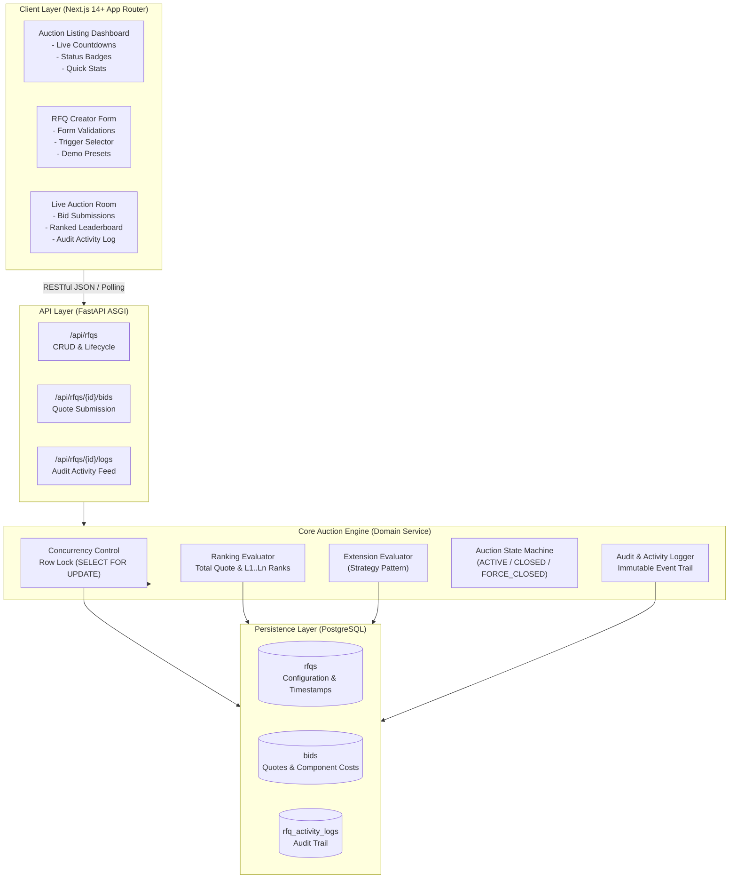
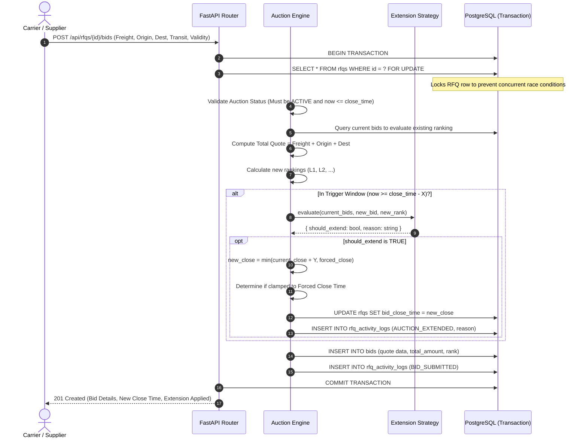
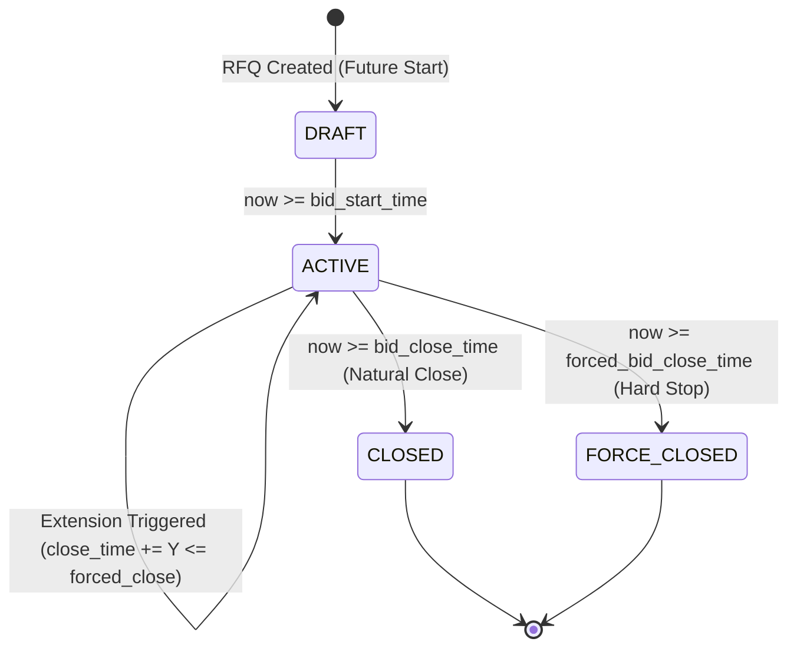

# High-Level Design (HLD): British Auction in RFQ System

## 1. Executive Summary & Problem Domain
In logistics and freight procurement, a **Request for Quotation (RFQ)** allows a shipper/buyer to request price quotes from multiple ocean/air carriers and logistics providers.
A standard fixed-deadline auction suffers from **bid sniping**—carriers hold their lowest quote until seconds before the deadline to prevent competitors from underbidding them. This limits price discovery and prevents buyers from obtaining the optimal market rate.

The **British Auction** solves this by:
1. Monitoring bidding activity during a **Trigger Window ($X$ minutes)** prior to the close time.
2. Dynamically extending the close time by **Extension Duration ($Y$ minutes)** whenever a qualifying bidding condition occurs.
3. Enforcing an absolute **Forced Bid Close Time** (hard ceiling) beyond which no extension is permitted, guaranteeing auction termination.

---

## 2. System Architecture

The system is architected as a decoupled, real-time-ready client-server system:



---

## 3. Core Domain Workflows

### 3.1 Bid Placement & Dynamic Extension Sequence



---

## 4. Design Patterns Applied

### 4.1 Strategy Pattern for Extension Rules
The assignment defines 3 distinct extension triggers. We decouple these via the **Strategy Pattern** to ensure extensibility without modifying core engine logic (Open/Closed Principle):

```
                       ┌─────────────────────────┐
                       │ ExtensionRuleStrategy   │
                       ├─────────────────────────┤
                       │ + should_extend(...)    │
                       └────────────▲────────────┘
                                    │
         ┌──────────────────────────┼──────────────────────────┐
         │                          │                          │
┌────────────────────────┐ ┌────────────────────────┐ ┌────────────────────────┐
│ BidReceivedStrategy    │ │ AnyRankChangeStrategy  │ │ L1RankChangeStrategy   │
├────────────────────────┤ ├────────────────────────┤ ├────────────────────────┤
│ Extends if any valid   │ │ Extends if any carrier │ │ Extends ONLY if the L1 │
│ bid arrives in window  │ │ position changes       │ │ lowest bidder changes  │
└────────────────────────┘ └────────────────────────┘ └────────────────────────┘
```

### 4.2 State Machine for Auction Lifecycle
An auction moves through distinct states based on wall-clock time and bidding events:



---

## 5. Non-Functional Requirements & Scalability

1. **Concurrency & Race Conditions**:
   * Critical during high-frequency bidding near closing time.
   * Handled via PostgreSQL row-level locks (`SELECT FOR UPDATE`) on the target RFQ, guaranteeing strict serialization of rank calculation and time extensions.
2. **Precision & Timezones**:
   * All timestamps stored in **UTC (ISO-8601)** with millisecond precision to eliminate local timezone drift.
3. **Auditability**:
   * Every state mutation (creation, bid, extension, forced close) produces an immutable record in `rfq_activity_logs` with the exact actor, timestamps, and justification.
4. **Resilience**:
   * If an auction passes its close time, status transitions are dynamically evaluated on read queries even if background workers are momentarily delayed.
