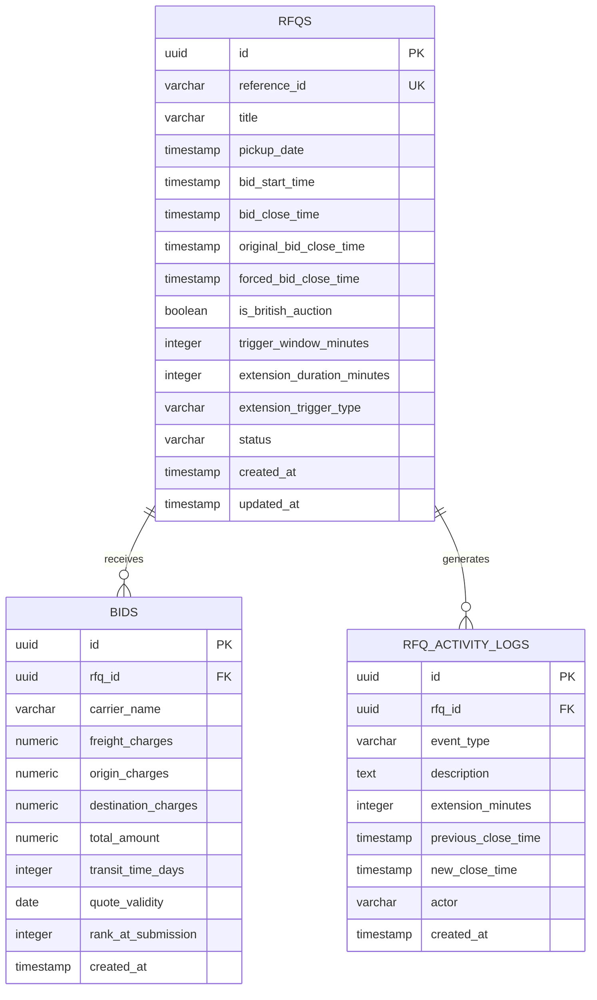

# Database Schema Design: British Auction in RFQ System

## 1. Entity-Relationship Overview



---

## 2. Detailed Table Specifications

### 2.1 Table: `rfqs`
Stores RFQ metadata, British Auction configuration, and mutable close timestamps.

| Column | Data Type | Constraints | Description |
| :--- | :--- | :--- | :--- |
| `id` | UUID | PRIMARY KEY, DEFAULT `gen_random_uuid()` | Unique RFQ identifier |
| `reference_id` | VARCHAR(50) | UNIQUE, NOT NULL | Human-readable ID (e.g., `RFQ-2026-001`) |
| `title` | VARCHAR(255) | NOT NULL | Cargo/Route name (e.g., `Shanghai to Rotterdam 40ft FCL`) |
| `pickup_date` | TIMESTAMP WITH TIME ZONE | NOT NULL | Target pickup / service date |
| `bid_start_time` | TIMESTAMP WITH TIME ZONE | NOT NULL | When bidding commences |
| `bid_close_time` | TIMESTAMP WITH TIME ZONE | NOT NULL | Dynamic close time (extended when triggered) |
| `original_bid_close_time`| TIMESTAMP WITH TIME ZONE | NOT NULL | Baseline close time prior to any extensions |
| `forced_bid_close_time` | TIMESTAMP WITH TIME ZONE | NOT NULL | Absolute hard close ceiling |
| `is_british_auction` | BOOLEAN | NOT NULL, DEFAULT TRUE | Feature toggle for dynamic British auction |
| `trigger_window_minutes`| NUMERIC(6,2) | NOT NULL, DEFAULT 10 | Trigger window $X$ before close time |
| `extension_duration_minutes`| NUMERIC(6,2) | NOT NULL, DEFAULT 5 | Extension duration $Y$ added upon trigger |
| `extension_trigger_type`| VARCHAR(50) | NOT NULL, DEFAULT `'BID_RECEIVED'` | Trigger rule: `BID_RECEIVED`, `ANY_RANK_CHANGE`, `L1_RANK_CHANGE` |
| `status` | VARCHAR(30) | NOT NULL, DEFAULT `'ACTIVE'` | State: `DRAFT`, `ACTIVE`, `CLOSED`, `FORCE_CLOSED` |
| `created_at` | TIMESTAMP WITH TIME ZONE | NOT NULL, DEFAULT `NOW()` | Audit creation timestamp |
| `updated_at` | TIMESTAMP WITH TIME ZONE | NOT NULL, DEFAULT `NOW()` | Audit update timestamp |

#### Table Constraints:
* `CHECK (bid_close_time > bid_start_time)`: Close time must be strictly after start time.
* `CHECK (forced_bid_close_time >= bid_close_time)`: Forced close must be strictly greater than or equal to initial close time.
* `CHECK (trigger_window_minutes > 0 AND extension_duration_minutes > 0)`: Configs must be positive numbers.

---

### 2.2 Table: `bids`
Stores carrier quotes, detailed charge breakdowns, transit terms, and computed totals.

| Column | Data Type | Constraints | Description |
| :--- | :--- | :--- | :--- |
| `id` | UUID | PRIMARY KEY, DEFAULT `gen_random_uuid()` | Unique bid identifier |
| `rfq_id` | UUID | FOREIGN KEY -> `rfqs(id)` ON DELETE CASCADE | Target RFQ |
| `carrier_name` | VARCHAR(100) | NOT NULL | Name of logistics provider / carrier |
| `freight_charges` | NUMERIC(14,2) | NOT NULL, CHECK ($\ge 0$) | Base ocean/air freight cost |
| `origin_charges` | NUMERIC(14,2) | NOT NULL, CHECK ($\ge 0$) | Port/drayage charges at origin |
| `destination_charges` | NUMERIC(14,2) | NOT NULL, CHECK ($\ge 0$) | Destination terminal / customs handling |
| `total_amount` | NUMERIC(14,2) | NOT NULL, CHECK ($> 0$) | Computed sum: `freight + origin + destination` |
| `transit_time_days` | INTEGER | NOT NULL, CHECK ($> 0$) | Estimated transit duration in days |
| `quote_validity` | DATE | NOT NULL | Expiry date of the submitted rate quote |
| `rank_at_submission`| INTEGER | NULLABLE | Snapshot rank (L1, L2, etc.) at placement |
| `created_at` | TIMESTAMP WITH TIME ZONE | NOT NULL, DEFAULT `NOW()` | Exact bid submission timestamp |

#### Table Indexes:
* `CREATE INDEX idx_bids_rfq_total ON bids(rfq_id, total_amount ASC, created_at ASC);`
  * Optimizes ranking retrieval: lowest total amount first, earlier submission breaks ties.

---

### 2.3 Table: `rfq_activity_logs`
Chronological, tamper-evident audit trail capturing every lifecycle change and extension reason.

| Column | Data Type | Constraints | Description |
| :--- | :--- | :--- | :--- |
| `id` | UUID | PRIMARY KEY, DEFAULT `gen_random_uuid()` | Unique log identifier |
| `rfq_id` | UUID | FOREIGN KEY -> `rfqs(id)` ON DELETE CASCADE | Associated RFQ |
| `event_type` | VARCHAR(50) | NOT NULL | Event classification (`RFQ_CREATED`, `BID_SUBMITTED`, `AUCTION_EXTENDED`, `AUCTION_CLOSED`, `AUCTION_FORCE_CLOSED`) |
| `description` | TEXT | NOT NULL | Human-readable audit narrative |
| `extension_minutes` | NUMERIC(6,2) | NULLABLE | Duration added (if extension event) |
| `previous_close_time`| TIMESTAMP WITH TIME ZONE | NULLABLE | Bid close timestamp before mutation |
| `new_close_time` | TIMESTAMP WITH TIME ZONE | NULLABLE | Bid close timestamp after mutation |
| `actor` | VARCHAR(100) | NOT NULL | Triggering entity (`System` or Carrier Name) |
| `created_at` | TIMESTAMP WITH TIME ZONE | NOT NULL, DEFAULT `NOW()` | Log creation timestamp |

#### Table Indexes:
* `CREATE INDEX idx_logs_rfq_created ON rfq_activity_logs(rfq_id, created_at DESC);`
  * Optimizes real-time audit log timeline queries.

---

## 3. Pure SQL DDL Scripts (PostgreSQL)

```sql
-- Create ENUM-like check types or tables
CREATE EXTENSION IF NOT EXISTS "uuid-ossp";

-- Table: rfqs
CREATE TABLE IF NOT EXISTS rfqs (
    id UUID PRIMARY KEY DEFAULT uuid_generate_v4(),
    reference_id VARCHAR(50) UNIQUE NOT NULL,
    title VARCHAR(255) NOT NULL,
    pickup_date TIMESTAMPTZ NOT NULL,
    bid_start_time TIMESTAMPTZ NOT NULL,
    bid_close_time TIMESTAMPTZ NOT NULL,
    original_bid_close_time TIMESTAMPTZ NOT NULL,
    forced_bid_close_time TIMESTAMPTZ NOT NULL,
    is_british_auction BOOLEAN NOT NULL DEFAULT TRUE,
    trigger_window_minutes NUMERIC(6,2) NOT NULL DEFAULT 10.0,
    extension_duration_minutes NUMERIC(6,2) NOT NULL DEFAULT 5.0,
    extension_trigger_type VARCHAR(50) NOT NULL DEFAULT 'BID_RECEIVED',
    status VARCHAR(30) NOT NULL DEFAULT 'ACTIVE',
    created_at TIMESTAMPTZ NOT NULL DEFAULT NOW(),
    updated_at TIMESTAMPTZ NOT NULL DEFAULT NOW(),
    CONSTRAINT chk_rfq_close_after_start CHECK (bid_close_time > bid_start_time),
    CONSTRAINT chk_rfq_forced_after_close CHECK (forced_bid_close_time >= bid_close_time),
    CONSTRAINT chk_rfq_positive_configs CHECK (trigger_window_minutes > 0 AND extension_duration_minutes > 0)
);

-- Table: bids
CREATE TABLE IF NOT EXISTS bids (
    id UUID PRIMARY KEY DEFAULT uuid_generate_v4(),
    rfq_id UUID NOT NULL REFERENCES rfqs(id) ON DELETE CASCADE,
    carrier_name VARCHAR(100) NOT NULL,
    freight_charges NUMERIC(14,2) NOT NULL CHECK (freight_charges >= 0),
    origin_charges NUMERIC(14,2) NOT NULL CHECK (origin_charges >= 0),
    destination_charges NUMERIC(14,2) NOT NULL CHECK (destination_charges >= 0),
    total_amount NUMERIC(14,2) NOT NULL CHECK (total_amount > 0),
    transit_time_days INTEGER NOT NULL CHECK (transit_time_days > 0),
    quote_validity DATE NOT NULL,
    rank_at_submission INTEGER,
    created_at TIMESTAMPTZ NOT NULL DEFAULT NOW()
);

-- Table: rfq_activity_logs
CREATE TABLE IF NOT EXISTS rfq_activity_logs (
    id UUID PRIMARY KEY DEFAULT uuid_generate_v4(),
    rfq_id UUID NOT NULL REFERENCES rfqs(id) ON DELETE CASCADE,
    event_type VARCHAR(50) NOT NULL,
    description TEXT NOT NULL,
    extension_minutes NUMERIC(6,2),
    previous_close_time TIMESTAMPTZ,
    new_close_time TIMESTAMPTZ,
    actor VARCHAR(100) NOT NULL,
    created_at TIMESTAMPTZ NOT NULL DEFAULT NOW()
);

-- Indexes
CREATE INDEX IF NOT EXISTS idx_rfqs_status ON rfqs(status);
CREATE INDEX IF NOT EXISTS idx_bids_rfq_total ON bids(rfq_id, total_amount ASC, created_at ASC);
CREATE INDEX IF NOT EXISTS idx_logs_rfq_created ON rfq_activity_logs(rfq_id, created_at DESC);
```
